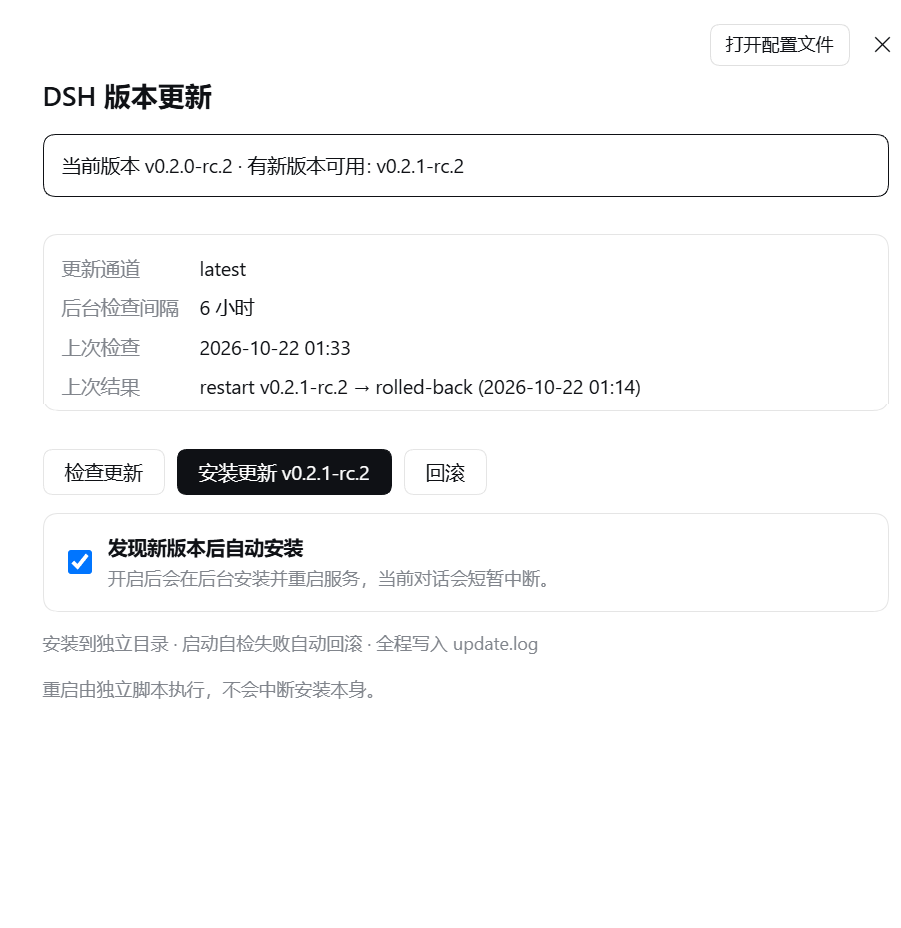

# dsh-auto-update

给 DeepSeek Harness（DSH）CLI 装一个**能安全升级自己**的插件：检查 `@deepseek-ai/dsh` 新版本、后台安装到独立目录、切换启动指针、健康检查失败自动回滚。网页端设置页里点按钮就行。

> **English TL;DR** — a DSH plugin that checks the npm dist-tag for `@deepseek-ai/dsh`, installs the new version **side by side** (never in place), smoke-tests the composed config, repoints a launcher pointer, restarts the web host from a process outside the host's job object, and rolls back automatically if the new version does not come up healthy. Windows only (PowerShell 5.1 + cmd). MIT.



<!-- 截图待补：放到 docs/settings-card.png 后取消上一行的注释；暂时删掉那行也可以 -->

## 为什么需要它

DSH CLI 没有 `update` 子命令——`dsh plugin` 只是把参数转发给 pnpm，装插件用；升级主程序得自己 `npm install`。而在**服务正在运行**时原地覆盖安装，结果是：旧进程还握着旧模块，新版本起不来时你也回不去了。

这个插件的前提只有一条：**永不原地升级正在运行的实例**。

## 设计原则

1. **旁路安装**：新版本装到 `<installBase>\dsh-install-<version>`，和当前实例完全隔离。
2. **先验证再切换**：`node bin.js --profile web --dump-config` 能组合出配置树（且退出码 0）才算装成功；装好才动启动指针。
3. **重启必须来自宿主之外**：进程内做不到原地复活。切换指针后由一个通过 WMI 拉起的进程接手（父进程是 `WmiPrvSE.exe`，不在任何 job 树里），宿主死掉不会连坐。
4. **起不来就退回去**：健康检查失败 → 指针切回旧版本 → 重启旧版本 → 写 `last-result.json`（`status: "rolled-back"`）。

## 组成

| 文件 | 作用 |
| --- | --- |
| `lib/index.js` | 宿主插件：`/status` `/check` `/apply` `/rollback` `/config` 接口 + 后台定时检查 + 自动应用 |
| `lib/client.js` | 设置页「载具更新」卡片（当前/最新版本、检查、安装、回滚、自动更新开关） |
| `apply-update.ps1` | 真正干活的脚本：npm 安装 → 冒烟 → 切指针 → 停旧起新 → 健康检查 → 失败回滚 |
| `cordis.patch.yml` | 把插件本体插进 loader |
| `examples/start-dsh-web.cmd` | **重启命令的模板**（插件不猜你怎么启动服务，见下文） |
| `test/handler.test.mjs` | 离线测试：临时目录里造一个假安装，直接驱动 HTTP handler，不碰真服务、不重启 |

## 安装

```powershell
# 从 GitHub 装（推荐；先 fork/clone 到本地也行，用 link: 指向本地目录）
dsh plugin --profile web add github:<你的用户名>/dsh-auto-update

# 或从本地目录装
dsh plugin --profile web add link:C:\path\to\dsh-auto-update
```

然后把它加进 profile 的 bundles（`%DSH_HOME%\profiles\web\package.json`）：

```json
{
  "dsh": { "profile": { "bundles": [ "...", "dsh-auto-update" ] } }
}
```

最后重启一次 web 宿主让插件加载（**这一步重启会掐掉当前对话的传输，页面上稍等重连**）。之后的升级就不用再手动重启了。

装之前先确认你的启动链就位（见下面「启动脚本契约」），否则插件会拒绝切换版本——这是刻意的：它宁可不动，也不把你留在一个起不来的版本上。

## 配置

### 环境变量（重启命令与指针目录）

插件不去猜你的目录结构，三件事全部可配置：

| 变量 | 默认 | 说明 |
| --- | --- | --- |
| `DSH_AUTO_UPDATE_LAUNCH_CMD` | *（空）* | 切换版本后用来重启 web 宿主的脚本。**没配置就不允许升级** |
| `DSH_AUTO_UPDATE_LAUNCHER_DIR` | `%DSH_HOME%\auto-update\launcher` | 启动指针 `current-root.txt` 所在目录 |
| `DSH_AUTO_UPDATE_BOOT_LOG` | *（空）* | 启动日志路径；配了才能把"起不来"的具体原因显示在卡片上 |
| `DSH_HOME` | `~/.dsh` | DSH 数据根；安装目录默认在它旁边 |

```powershell
setx DSH_AUTO_UPDATE_LAUNCH_CMD "C:\tools\start-dsh-web.cmd"
setx DSH_AUTO_UPDATE_LAUNCHER_DIR "C:\tools\dsh-launcher"
setx DSH_AUTO_UPDATE_BOOT_LOG "C:\tools\start-dsh-web.log"
```

### profile 配置（`cordis.patch.yml`）

```yaml
- id: dsh-auto-update
  name: dsh-auto-update
  config:
    enabled: true
    channel: latest      # latest | next | alpha
    intervalHours: 6
    autoApply: false     # true = 定时检查到新版本就自动装
    registry: ""         # 空 = npm 默认源；可填镜像，例如 https://registry.npmmirror.com
```

运行时修改（设置页开关、接口调用）落到 `%DSH_HOME%\auto-update\config.json`，优先级高于 patch 里的默认值。

## 启动脚本契约

插件只负责**切换指针**，起进程这一步交给你自己的脚本。`examples/start-dsh-web.cmd` 是一份可直接改的模板，要点：

1. **指针只写版本号**（如 `0.2.1-rc.2`），脚本自己拼出安装目录。原因：`current-root.txt` 由 cmd.exe 按 OEM 代码页读取，写完整路径时，**用户名含非 ASCII 字符的机器**（如 `C:\Users\张三\...`）会读成乱码，然后静默判成"安装不存在"。只存 ASCII 版本号则任何代码页都安全。
2. 脚本读不到指针时，按 `dsh-install-*` 目录名倒序回退到最新的完整安装。
3. 一定要把 stdout/stderr 落盘（模板写同目录 `web-run.out.log`，并自行轮转）——否则"90 秒没起来"这种故障无从查起。

## 接口

全部在 `/dsh-auto-update/api` 下。**写操作**必须带 `x-dsh-auto-update: 1` 头（挡跨站表单/图片式 CSRF；浏览器跨站发不出自定义头）。

| 方法 | 路径 | 说明 |
| --- | --- | --- |
| GET | `/status` | 当前/最新版本、通道、可用更新、上次结果、挂起任务、`canRestart` |
| GET | `/health` | 存活探针 |
| POST | `/check` | 查 registry 的 `latest`/`next`/`alpha`，写 `state.json` |
| POST | `/apply` | 后台安装，body 可带 `{"version":"x.y.z"}`，默认最新版 |
| POST | `/rollback` | 回到 `previous-root.txt` 记录的版本 |
| POST | `/config` | 改 `autoApply` / `intervalHours` / `channel` / `registry`，落 `config.json` |

```powershell
$base = "http://127.0.0.1:3080/dsh-auto-update/api"
curl.exe -s "$base/status"
curl.exe -s -X POST "$base/check" -H "x-dsh-auto-update: 1"
curl.exe -s -X POST "$base/apply" -H "x-dsh-auto-update: 1" -H "content-type: application/json" -d "{}"
curl.exe -s -X POST "$base/rollback" -H "x-dsh-auto-update: 1"
```

## 升级流程（`apply-update.ps1`）

1. 抢锁（`apply.lock`，超过 120 分钟的陈旧锁自动接管）
2. `npm install @deepseek-ai/dsh@<version>` 到 `<installBase>\dsh-install-<version>`（可与已装版本复用）
3. `node bin.js --profile web --dump-config` 冒烟：组合出配置树才算装成功
4. 记录旧根到 `previous-root.txt`，把指针指向新版本
5. **交接**：WMI 拉起 stage-2 进程，本进程立刻退出
6. stage-2 停旧实例：只杀监听端口的 PID，再补一轮命令行含 `--profile web` 的 node
7. 用你的重启命令拉起新实例
8. 轮询 `/api/pair/status` 最多 150 秒（20 秒后放宽为端口可连）
9. 失败 → 指针切回旧版本 → 重启 → `last-result.json` 记 `rolled-back`

手动排障（不下载、不切指针、不重启）：

```powershell
$ps = 'C:\path\to\dsh-auto-update\apply-update.ps1'

# 纯计划
powershell -NoProfile -ExecutionPolicy Bypass -File $ps -Mode apply -Version 0.2.1-rc.2 -CurrentRoot C:\path\to\dsh-install-0.2.0-rc.2 -DryRun

# 只安装 + 冒烟，不激活
powershell -NoProfile -ExecutionPolicy Bypass -File $ps -Mode apply -Version 0.2.1-rc.2 -CurrentRoot C:\path\to\dsh-install-0.2.0-rc.2 -StageOnly
```

`-DryRun` 的早退发生在 `npm install` **之前**——不存在"dry run 也真装了"的情况。

## 为什么重启要绕道 WMI

宿主只能被**不在它 job 树里**的进程重启。插件拉起的 `apply-update.ps1` 是 web 宿主的子进程，而 DSH 的 `subprocess-local` 会给工具树套 job object：宿主一死，job 关闭，整棵树一起没了。实践中表现出来的样子是——重启脚本日志停在 `stopped pid ...` 那行，后面重启的几行**永远不执行**（这类脚本我写过三个，三个都这样死掉）。

所以指针一切换就立刻 relinquish 控制权：`Win32_Process.Create` 让新进程的父进程变成 `WmiPrvSE.exe`，没有任何 job 覆盖它，stage-2 一定活到把新宿主拉起来。

失败恢复也不放在 `catch` 里：会抛异常的地方都在指针切换**之前**，那时旧实例还在正常服务，什么都不用做；切换之后的健康检查与回滚由 stage-2 独占。

## 安全边界

- **安装目录白名单**：只安装到 `<installBase>\dsh-install-<version>`，不会把 `npm install` 引向任意目录
- **版本串校验**：`^\d+\.\d+\.\d+(?:-[0-9A-Za-z.]+)?$`，且必须比当前版本新（想降级请走 `/rollback`）
- **写操作要护栏头**：见上，非凭证、只为挡 CSRF
- **没配重启命令就拒绝升级**：`apply` / `rollback` 会在动指针前失败，不会留下起不来的 profile
- **默认只查不装**：`autoApply: false`，自动更新必须用户在设置页显式打开

## 状态文件

`%DSH_HOME%\auto-update\`

| 文件 | 内容 |
| --- | --- |
| `config.json` | 用户在网页上改过的配置 |
| `state.json` | 最新 tag 表、上次检查时间、上次结果、进行中的任务 |
| `last-result.json` | 脚本结论：`pending` / `ok` / `rolled-back` / `failed` / `staged` / `dry-run` |
| `update.log` | 每次升级的完整日志（含 npm 输出） |
| `apply.lock` | 单实例锁 |
| `launcher/current-root.txt` | 启动指针（只存版本号；目录可由 `DSH_AUTO_UPDATE_LAUNCHER_DIR` 改变） |

## 排障

- **升级后起不来**：先看 `last-result.json`，卡片上也会带 `Cause:`（取自启动日志的首条错误行）。手动 `-Mode rollback -TargetRoot <旧根>` 可立刻回退。
- **registry 太慢**（某些网络下 `npm install` 要几分钟）：把 `registry` 指到镜像，插件的查询和 `npm install --registry` 都会跟着走。
- **新版拒绝 `host: '0.0.0.0'`**：`dsh-host-webserver` 的较新版本不再允许通配地址绑定（"binding every interface would expose remote code execution to the network"）。如果你的 profile patch 里留着 lan-bind 的 `host: '0.0.0.0'`，升级后会在 webserver 处启动失败并自动回滚。改成 `127.0.0.1`（远程访问交给隧道/中继）或某个具体网卡地址，再升级。
- **网页升级中途断开**：正常现象，宿主被重启了；页面重连后卡片会显示结果。

## 测试

```powershell
node test/handler.test.mjs                                   # 全部（含一次 registry 查询）
$env:DSH_AUTO_UPDATE_OFFLINE=1; node test/handler.test.mjs    # 跳过网络
```

测试在系统临时目录里造一个假安装（含 `bin.js`、`package.json`、指针文件）并把 `DSH_HOME` 指过去，所以**在没装过 dsh 的机器上也能全绿**，也不会碰你的真实 profile。

## 已知限制

- 只更新 `@deepseek-ai/dsh` 主包，不动 profile 里的插件（插件各自更新）
- Windows 专用：重启链依赖 PowerShell 5.1 + cmd.exe 的实例语义
- `next` / `alpha` 是预发布通道，别在生产开
- 升级期间网页会短暂断连（服务确实被重启了）

## License

MIT
